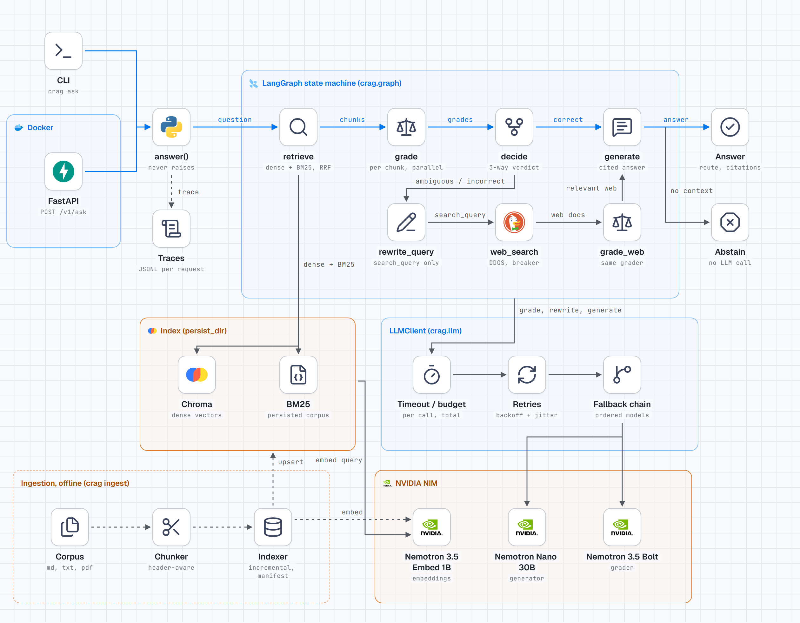

# corrective-rag

A Corrective RAG (CRAG) pipeline as a LangGraph state machine on NVIDIA NIM. It grades every
retrieved chunk, routes on the result, falls back to web search once when the corpus cannot answer,
and either answers with numbered citations or says it does not know.

## What it shows

- A pure routing function (`decide`) and an acyclic graph: the correction path runs at most once.
- Hybrid retrieval (BM25 + dense, fused with RRF) over an incrementally indexed corpus.
- A single LLM client that owns retries, model fallback and a time budget, so nodes stay simple.
- A public `answer()` that never raises on runtime faults; it degrades and reports.
- An eval harness that compares this version with the original (`v0-baseline`), including fault injection.

## Architecture



Dark variant: [`runtime-architecture-dark.png`](docs/diagrams/runtime-architecture-dark.png).
Eval harness: [`eval-harness.png`](docs/diagrams/eval-harness.png). Details in
[`docs/ARCHITECTURE.md`](docs/ARCHITECTURE.md).

How a question flows:

1. `answer()` validates the question (empty or too long raises `ValueError`; nothing else raises).
2. `retrieve` gets `fetch_k` candidates from BM25 and from Chroma and fuses them with RRF.
3. `grade` asks the grader model, per chunk and in parallel, whether the chunk helps. A grading failure keeps the chunk.
4. `decide` counts relevant chunks: enough means answer locally; some means keep them and add web; none means discard local and use web only.
5. On the web path, `rewrite_query` writes a search query (the original question is kept), `web_search` queries DuckDuckGo behind a timeout and circuit breaker, and `grade_web` grades the results.
6. `generate` answers the original question from the surviving context with `[N]` citations. If no context survives it abstains with a fixed message and makes no LLM call.
7. The result carries the route, citations, degraded flag, errors and a trace id; one JSONL trace is written per request.

## Before and after

Earlier state is tag `v0-baseline`.

| Capability | v0 | v1 |
|---|---|---|
| Retrieval | Dense Chroma only | Hybrid BM25 + dense with RRF; falls back to the surviving retriever |
| Routing | Two-way: enough relevant chunks, or rewrite + web | Three-way CRAG verdict: local, local + web, web only |
| Failure handling | None: a provider error or empty structured output raises | Error taxonomy, retries with backoff, model fallback, budget, fail-open grader, circuit-broken web search, `degraded` flag |
| Question overwrite | The rewrite node replaced `question`, so the final answer addressed the rewritten query | `question` is never overwritten; the rewrite goes to `search_query` |
| Citations and abstention | Not present | `[N]` citations validated against the context; fixed abstain message when nothing grounds an answer |
| Ingest | Single module that builds a Chroma index from the corpus | Header-aware chunking; incremental indexer with a file-hash manifest (an unchanged rerun makes no embedding calls) |
| API | CLI only | CLI plus FastAPI (`/v1/ask`, `/healthz`, `/readyz`) and a Dockerfile |
| Tests | Mocked unit tests | Offline tests with fakes at the client boundary (key unset) covering routing, retrieval, ingest, reliability and the API |
| Eval | Small scripts | Eval set, corpus with distractors, v0/v1 adapters, fault injector, judge, report |
| CI | None | ruff, offline tests, offline chaos smoke with a gate, manual live-eval job |

## Results

Full tables, models, corpus hash and run metadata: [`eval/RESULTS.md`](eval/RESULTS.md).

Offline fault-injection, fake models, robustness only (not answer quality). 40 questions per run,
seed 7; the fault rate is per provider call. Values copied from `eval/RESULTS.md`:

| Fault rate | System | Crash rate | Error recovery rate | Clean among faulted |
|---|---|---|---|---|
| 0.05 | v0 | 37.5% | 0.0% | 0.0% |
| 0.05 | v1 | 0.0% | 100.0% | 54.5% |
| 0.1 | v0 | 55.0% | 0.0% | 0.0% |
| 0.1 | v1 | 0.0% | 100.0% | 56.2% |
| 0.3 | v0 | 95.0% | 0.0% | 0.0% |
| 0.3 | v1 | 0.0% | 100.0% | 48.6% |

v1's 100% recovery follows from the contract that `answer()` never raises, so it says little alone.
Read it with "clean among faulted": the share of faulted questions that still got a real,
non-degraded answer. These runs used fakes and a blocked network.

### Live quality, measured 2026-11-11

Same 40 questions, corpus and judge (`deepseek-ai/deepseek-v4.1-flash`) for both; both on the
Nemotron generator and embedder (v0's original models are retired). Values copied from `eval/RESULTS.md`.

| Metric | v0 | v1 |
|---|---|---|
| Crash rate (no injected faults) | 17.5% | 0.0% |
| Retrieval hit@4 | 85.7% | 100.0% |
| MRR | 0.73 | 0.86 |
| Answer correctness, 28 in-corpus questions (judge) | 60.7% | 67.9% |
| Key-fact match (deterministic) | 89.5% | 81.8% |
| Faithfulness (judge) | 96.7% | 96.2% |
| Routing accuracy (exact) | 50.0% | 77.5% |
| Abstention on 6 unanswerable questions | 16.7% | 100.0% |
| False abstention, in-corpus | 0.0% | 3.6% |
| Web search unavailable, share of questions | 17.5% | 55.0% |
| Latency p50 | 12.5 s | 2.8 s |

How to read it:

- **Crashes.** v0's 7 crashes are all `DDGSException: No results found` from live DuckDuckGo, with
  no injected faults. That is the failure the reliability work targets, seen in the wild.
- **Web outage.** DuckDuckGo (free, no key) was mostly down during the v1 run, so v1's circuit breaker
  skipped the web for 55% of questions. Only retrieval (hit@4, MRR) is independent of the web. Crash
  rate, routing, correctness, abstention, web answer rate (0% for both) and latency all carry the
  outage: v0's web crashes count as wrong answers, and 10 of v1's 28 in-corpus questions ran without
  the web fallback.
- **Correctness.** +7 points is 2 questions out of 28; at this size that is suggestive, not proof.
  Crashed v0 questions count as wrong. The judge is strict: an answer missing a condition
  ("18" without "and a legal resident") scores 0.
- **Key-fact match drop.** Mostly selection: v0's crashed rows are unscored. On the 19 rows both
  scored it is 89.5% vs 84.2%, a net of one question: v1 gained q25 (the right 25.00% APR, where v0
  said 16%) and lost q29 (answered "Yes. [1]" without the numbers) and q33 (abstained while the web
  was down).
- **Retrieval** is the clearest gain: hybrid BM25 + dense found the evidence for every question.

Grader ablation (v1 with the 30B generator as grader instead of `nemotron-3.5-bolt-e4b`): correctness
71.4% vs 67.9% (one question), routing 82.5% vs 77.5%, at 2.8x the median latency, 1.7x the provider
calls and 1.2 retries per question. The small grader stays the default. Web was down less during that
run (30% vs 55%), so the quality deltas are within noise and confounded; the cost rows are the signal.

## Metrics glossary

- **hit@k**: of the questions that have known evidence, the share where that evidence text appears in the top k retrieved chunks. It tests retrieval alone, before any model writes anything.
- **MRR** (mean reciprocal rank): for each question take 1 / the rank of the first chunk containing the evidence, then average. 1.0 means always first; 0 means never found.
- **Faithfulness**: whether the claims in the answer are supported by the context the model was given. A judge model scores it.
- **Correctness**: whether the answer matches the written ground truth. A judge model (different from the generator) decides; an abstention counts as wrong.
- **Abstention accuracy**: on questions that cannot be answered, how often the system declined instead of guessing.
- **Error recovery rate**: among questions where at least one fault was injected, the share that finished without crashing and returned an answer or an explicit abstain.
- **Clean among faulted**: among the same faulted questions, the share that returned a real answer that was neither degraded nor an abstain. A stricter view than recovery.
- **BM25**: a keyword ranking function. It scores chunks by how many question terms they contain, weighted by how rare each term is. Strong on exact identifiers such as fee codes.
- **RRF** (Reciprocal Rank Fusion): merges several ranked lists by summing 1 / (k + rank) per chunk, so chunks ranked well by both BM25 and dense search rise to the top, without comparing their raw scores.
- **RAGAS**: an open-source library of LLM-judged RAG metrics (such as faithfulness and context precision). Optional here via `--ragas`; not required and not used for any published number.

## Run

Python 3.11. The shared venv lives at the repo root, and the root `.env` holds `NVIDIA_API_KEY`
(see the root README).

```powershell
cd corrective-rag
..\.venv\Scripts\python.exe -m pip install -e ".[dev]"

# build or refresh the index from data/corpus (idempotent); add --rebuild to re-embed everything
..\.venv\Scripts\python.exe -m crag.cli ingest

# ask
..\.venv\Scripts\python.exe -m crag.cli ask "What is the late fee on a personal loan?"
..\.venv\Scripts\python.exe -m crag.cli ask "What is the late fee on a personal loan?" --json

# HTTP API
..\.venv\Scripts\python.exe -m crag.cli serve --port 8000
Invoke-RestMethod -Method Post http://127.0.0.1:8000/v1/ask -ContentType application/json -Body '{"question":"What is the late fee on a personal loan?"}'
```

Docker (written from the Dockerfile; not exercised here). The image holds no index, so build it
inside the container:

```powershell
docker build -t crag .
docker run --rm --env-file ..\.env -p 8000:8000 crag sh -c "crag ingest && crag serve --host 0.0.0.0"
```

The corpus in `data/corpus/` is synthetic (see `data/README.md`).

## Tests

Offline; the key must be unset.

```powershell
..\.venv\Scripts\python.exe -m pytest -q tests eval/tests
..\.venv\Scripts\python.exe -m ruff check .
```

## Eval commands

```powershell
# offline chaos (fakes, no key); one git-ignored result file per rate
..\.venv\Scripts\python.exe -m eval.run --system v1 --suite chaos --offline --rates 0,0.05,0.1,0.3 --seed 7
..\.venv\Scripts\python.exe -m eval.run --system v0 --src ..\..\RAG_Learning_v0\corrective-rag\src --suite chaos --offline --rates 0,0.05,0.1,0.3 --seed 7

# live quality (needs the key; makes real API calls)
..\.venv\Scripts\python.exe -m eval.run --system v1 --suite quality

# rebuild eval/RESULTS.md from the latest recorded runs
..\.venv\Scripts\python.exe -m eval.report
```

`v0` needs a checkout of tag `v0-baseline`, for example `git worktree add ..\..\RAG_Learning_v0 v0-baseline`.

## Models

The defaults changed on 2026-11-11 because NVIDIA retired the Llama 3.x, Mixtral and
nv-embedqa-e5-v5 endpoints (HTTP 410). Roles now: generator `nvidia/nemotron-3-nano-omni-30b-a3b-reasoning`,
grader `nvidia/nemotron-3.5-bolt-e4b`, fallbacks `nvidia/nemotron-3.5-lightning-30b-a3b` then the grader model,
embeddings `nvidia/nemotron-3.5-embed-1b`, eval judge `deepseek-ai/deepseek-v4.1-flash` (a different
family from the generator). The live eval for v0 ran on the same new generator and embedding model, because
its original models no longer exist.

## Configuration

Environment variables use the prefix `CRAG_` (the key is plain `NVIDIA_API_KEY`). Values are
validated at startup.

| Variable | Default | Meaning |
|---|---|---|
| `NVIDIA_API_KEY` | none | NIM key, from the root `.env` |
| `CRAG_LLM_MODEL` | `nvidia/nemotron-3-nano-omni-30b-a3b-reasoning` | generator |
| `CRAG_GRADER_MODEL` | `nvidia/nemotron-3.5-bolt-e4b` | relevance grader |
| `CRAG_FALLBACK_MODELS` | `nvidia/nemotron-3.5-lightning-30b-a3b`, `nvidia/nemotron-3.5-bolt-e4b` | tried in order after retries fail |
| `CRAG_EMBED_MODEL` | `nvidia/nemotron-3.5-embed-1b` | embeddings |
| `CRAG_RETRIEVAL_MODE` | `hybrid` | `hybrid`, `dense` or `bm25` |
| `CRAG_TOP_K` / `CRAG_FETCH_K` / `CRAG_RRF_K` | 4 / 12 / 60 | final chunks, candidates per retriever, RRF constant |
| `CRAG_CORRECT_THRESHOLD` / `CRAG_AMBIGUOUS_THRESHOLD` | 2 / 1 | relevant chunks needed for each verdict |
| `CRAG_LLM_MAX_TOKENS` | 4096 | output cap per chat call, reasoning tokens included; raise `CRAG_LLM_TIMEOUT_S` with it |
| `CRAG_LLM_TIMEOUT_S` / `CRAG_LLM_TOTAL_BUDGET_S` | 30 / 90 | per call, per request |
| `CRAG_MAX_RETRIES` / `CRAG_BACKOFF_BASE_S` | 3 / 0.5 | transient-error retries |
| `CRAG_WEB_ENABLED` | `true` | `false` never uses the web |
| `CRAG_PERSIST_DIR` / `CRAG_CORPUS_DIR` / `CRAG_TRACE_DIR` | project subfolders | index, corpus, traces |

## Known limits

- Web fallback depends on free DuckDuckGo, which was unavailable for much of the live run; a keyed
  search API (Brave, Tavily) is the next improvement for the web route. Live chaos has not been run.
- The generator is sometimes too terse ("Yes. [1]" for a comparison question).
- An empty reply cut off at the token cap (`finish_reason=length`) is retried like a transient error, though a retry usually repeats it; with the 4096 cap this did not recur in testing.
- The eval set is small (40 questions, 6 to 14 per category), so differences of a few points are noise.
- The corpus is synthetic, and the judge is an LLM, so judged scores carry its bias and variance.
- The circuit breaker state is per process, not shared across workers.
- Web results are whatever DuckDuckGo returns; the pipeline grades them but cannot verify them.
- Grading adds one model call per chunk, so latency and cost grow with `top_k`.
