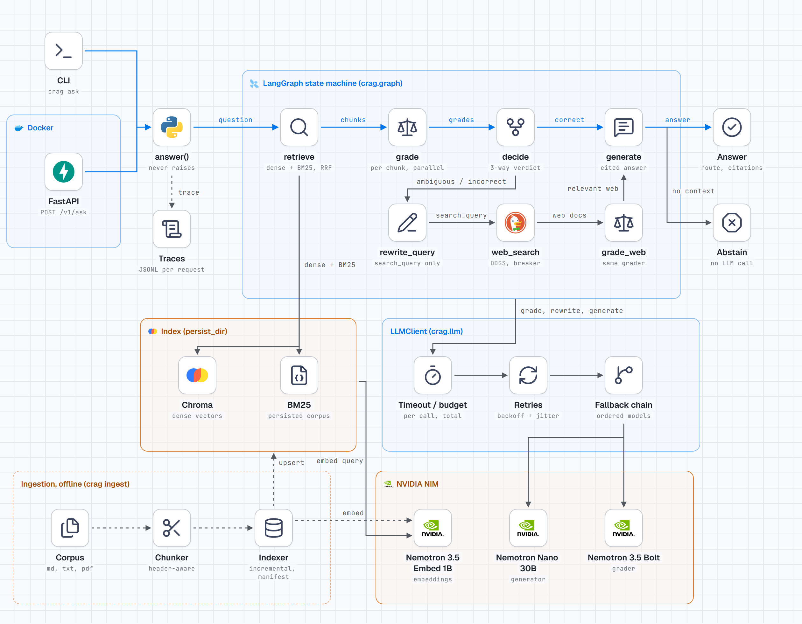

# Architecture (v1)



Dark variant: `diagrams/runtime-architecture-dark.png`. Eval harness: `diagrams/eval-harness.png`.

## Components

| Module | Responsibility |
|---|---|
| `config.py` | `Settings` (pydantic-settings, `CRAG_` prefix, validated). Reads the repo-root `.env`, then the project `.env`. |
| `llm.py` | `LLMClient`: the only caller of the chat model. Timeout, retries with backoff and jitter, model fallback chain, total budget, structured-output parse fallback. |
| `retrieval.py` | `Retriever`: dense (Chroma), BM25, or hybrid via Reciprocal Rank Fusion. Degrades to the surviving retriever on failure. |
| `ingest/` | Loader, header-aware chunker, incremental indexer (manifest of file hashes). |
| `nodes/` | `retrieve`, `grade`, `rewrite_query`, `web_search`, `grade_web`, `generate`. |
| `graph.py` | `build_graph()` and the pure `decide()`. |
| `pipeline.py` | `answer(question)` returns an `Answer`; raises only `ValueError` for invalid input. |
| `api.py`, `cli.py` | FastAPI (`POST /v1/ask`, `/healthz`, `/readyz`) and the `crag` command. |
| `observability.py` | `RunContext` per request (spans, LLM calls, retries, errors, degraded flag) and one JSONL trace per request. |

## Graph topology

```
retrieve -> grade -> decide --correct--------------------------> generate -> END
                        \--ambiguous / incorrect--> rewrite_query -> web_search -> grade_web -> generate
```

The graph is acyclic: the correction path runs at most once, by topology.

## State

`CRAGState` is a `total=False` TypedDict; nodes return partial updates. `question` is the original
question and is never overwritten. `rewrite_query` writes `search_query`, which only `web_search`
reads, and `generate` always answers `question`. Other keys: `chunks`, `grades`, `web_chunks`,
`web_grades`, `verdict`, `answer`, `citations`, `route`, `abstained`, `steps`.

## Routing table

Relevant count n comes from the per-chunk grades (defaults: `correct_threshold` 2, `ambiguous_threshold` 1).

| Verdict | Condition | Next | Context used by `generate` | Route |
|---|---|---|---|---|
| correct | n >= correct_threshold | generate | relevant local chunks | `local` |
| ambiguous | ambiguous_threshold <= n < correct_threshold | rewrite_query | relevant local + relevant web | `local+web` |
| incorrect | n = 0 | rewrite_query | relevant web only | `web` |
| no context | nothing relevant survives, or web disabled/failed with no local | generate | none | `abstain` (fixed message, no LLM call) |

With `CRAG_WEB_ENABLED=false`, `decide()` always goes to `generate`.

## Reliability

- Errors are classified as transient (timeout, 429, 5xx, connection), permanent (other 4xx) or parse errors. Only transient errors are retried.
- After retries are exhausted the client moves down the fallback model chain; a per-call timeout and a total budget bound the time spent.
- The grader is fail-open: a chunk whose grading fails is kept and the error is recorded.
- Web search has a timeout and a circuit breaker (opens after consecutive failures, half-open trial after a cooldown). A failure yields no web results, not an exception.
- If generation fails, the answer degrades to an extract of the top source.
- `Answer.degraded` and `Answer.errors` tell the caller what was reduced. Tracing failures never break a request.

## Retrieval

Hybrid retrieval fetches `fetch_k` candidates from Chroma (embedding via `nemotron-3.5-embed-1b`) and from BM25, fuses the two rankings with RRF (`rrf_k`), and returns the top `top_k`. BM25 catches exact identifiers such as fee codes that embeddings blur; dense retrieval catches paraphrase. If embeddings are down, retrieval falls back to BM25 and marks the request degraded.

## Prompt-injection hygiene

Retrieved and web text is wrapped in `<doc id=N>` blocks and the prompts tell the model to treat it as data. Citation ids that do not exist are stripped.
