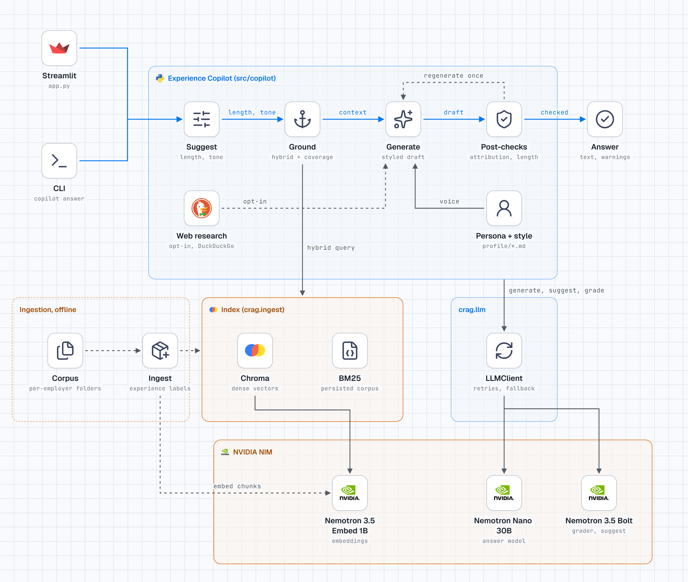

# experience-copilot

Ask a question about your own experience ("What pipeline are you proudest of?", "Why this company?")
and get a draft answer grounded in your own documents, in your voice, with controls for length
(short, medium, long) and tone (formal, professional, conversational, humanized). It is for drafting
and practising answers, not for reading them out verbatim.

## What it shows

- Reuse of `corrective-rag` (`crag`) as a library: hybrid retrieval, the resilient `LLMClient`, the incremental indexer and the web search node.
- Grounding with an explicit coverage decision that works in fast mode too (no grading call).
- Deterministic post-checks on generated text (attribution and length) instead of trusting the prompt.
- Configuration through an explicit `Settings` object, with no environment mutation.

## Architecture



Dark variant: [`architecture-dark.png`](docs/diagrams/architecture-dark.png).

How a question flows:

1. **Suggest** picks a length and tone from the question (you can override). It uses the grader model through `LLMClient` and falls back to a keyword heuristic, so it never fails.
2. **Ground** runs hybrid retrieval over the experience index, then decides coverage:
   - Entity check (both modes): if the question names an organisation or project (a capitalised word, e.g. "at Fabrikam") that is not one of your experience labels and not in any retrieved chunk, it is not covered: "names Fabrikam, which isn't in your documents".
   - Fast mode (default, no LLM call), first rule that fires wins: (b) the question names one of your experience labels and a retrieved chunk carries it ("anchored on Northwind"); (c) it names an entity such as Kafka that appears in a retrieved chunk; (d) a chunk shares at least `EXP_LEXICAL_MIN_HITS` specific terms with the question. Generic nouns (data, pipeline, project, design...) and interview filler (handle, solved, problem, proud, ship...) do not count, but a two-word phrase found verbatim ("data quality") counts as one hit. A question with no specific term is never covered ("What data pipeline are you most proud of?" is not, since every word is generic or filler; "What billing pipeline are you most proud of?" is). Dense similarity never marks a question covered by itself; it can only veto a match below `EXP_DENSE_THRESHOLD`.
   - Graded mode: the grader model scores each chunk in parallel (fail-open); covered if at least `EXP_COVERAGE_THRESHOLD` chunks are relevant. If grading fails, the fast rule decides.
3. **Generate** builds a prompt from the persona, style samples, length and tone spec and the `<doc>`-wrapped context, and calls the model through crag's `LLMClient` (retries, fallback, budget).
4. **Post-checks** run on the full text:
   - Attribution guard: an employer name in the answer must belong to a chunk that was used (or be named in the question or notes). Root-level files such as `resume.md` are not treated as employers; common-word employer names can be exempted with `EXP_ATTRIBUTION_IGNORE`.
   - Length compliance: short 40-90, medium 90-170, long 180-330 words.
   - On a violation it regenerates once with a corrective instruction; if still violated, the answer is returned with warnings.
5. **Web research** is opt-in (`--web` or the sidebar checkbox), uses crag's DuckDuckGo search, and is labelled as not from your documents. Results are wrapped in escaped `<web>` blocks that the prompt treats as untrusted data; search errors are shown in the CLI and the app.

`README*` files, dotfiles and dot-directories in the corpus are skipped at ingest; an empty corpus makes `copilot ingest` exit 1.

There is no streaming: the checks need the full text, and a streamed draft that is then regenerated
would show text that gets retracted.

## Before and after

Earlier state is tag `v0-baseline`.

| Area | v0 | v1 |
|---|---|---|
| Configuration | `configure_crag` wrote crag settings into `os.environ` | An explicit crag `Settings` built by `Settings.to_crag_settings()`; the environment is never written |
| Coverage warning | Only judged when grading was on, so the default fast mode never warned about thin coverage | Coverage is decided in fast mode too (entity check + specific-term overlap, dense as a veto) and in graded mode |
| Answer checks | None | Attribution guard and length compliance, one regenerate, then warnings |
| LLM calls | Own `llm.py` module | Through crag's `LLMClient` (retries, fallback, budget) |
| Index | Reused crag's loader and chunker; `build_index` rebuilt the whole index | crag's incremental indexer with an enricher that labels each chunk with its experience |
| Tests and CI | Unit tests, not run in CI | Offline tests with fakes; ruff and tests run in CI |

## The example corpus

`examples/` holds a fictional persona ("Alex Rivera"), two invented employers (Northwind, Contoso)
and their project notes. It is for tests, demos and the small eval. Nothing in it describes a real
person or company. To use it:

```powershell
$env:EXP_CORPUS_DIR = "examples/corpus"
$env:EXP_PERSIST_DIR = "chroma_store_demo"
$env:EXP_PERSONA_PATH = "examples/persona.md"
$env:EXP_STYLE_PATH = "examples/style_examples.md"
copilot ingest
copilot answer "What billing pipeline did you build at Northwind?" --fast
```

(These variables are only for this shell; the copilot itself does not set them.)

## What you provide

1. `profile/persona.md` (copy `persona.example.md`): who you are and your voice rules.
2. `profile/style_examples.md` (copy `style_examples.example.md`): two or three samples of your own writing.
3. `data/corpus/<Employer>/...`: your `.md`, `.txt` or `.pdf` documents (`interview/<Employer>/...` also maps to the employer).

These are git-ignored.

## Run

The key lives in the repo-root `.env` (`NVIDIA_API_KEY`), shared with corrective-rag.

```powershell
cd experience-copilot
..\.venv\Scripts\python.exe -m pip install -e ..\corrective-rag
..\.venv\Scripts\python.exe -m pip install -r requirements.txt
..\.venv\Scripts\python.exe -m pip install -e .

copilot ingest
copilot answer "What billing pipeline are you most proud of?" --length medium --tone humanized --fast
streamlit run app.py
```

Flags: `--length`, `--tone` (`auto` lets the suggester choose), `--notes`, `--model`, `--fast`
(skip grading), `--web`. Exit code 2 means the key is missing or still a placeholder.

## Tests

Offline; the key must be unset.

```powershell
..\.venv\Scripts\python.exe -m pytest -q
..\.venv\Scripts\python.exe -m ruff check .
```

## Eval

Results: [`eval/RESULTS.md`](eval/RESULTS.md). 17 hand-labelled questions (12 answerable, 5 not)
over the fictional corpus, live models, 2026-11-11/12. Three single runs, so read the changes as
indicative: one question moves a rate by about 6 points, and later runs differ from the first by
run-to-run variance as well as by the fixes. All three record commit `f2b924c` because the fixes
were uncommitted at the time.

| Metric | Run 1 (before fixes) | Run 2 (after fixes) | Run 3 (after fixes, published) |
|---|---|---|---|
| Attribution-error rate | 0% | 0% | 0% |
| Length-compliance rate | 82% | 94% | 100% |
| Answers needing a regeneration | 47% | 38% | 29% |
| Coverage accuracy, fast mode | 88% | 100% | 100% |
| Coverage accuracy, graded mode | 100% | 94% | 100% |
| Answers generated | 17 of 17 | 16 of 17 | 17 of 17 |
| Grounding (judge) | 1 of 12 judged (not published) | 0 of 12 judged | 0 of 12 judged |

The regeneration rate includes out-of-KB questions, which regenerate for the coverage warning rather
than length.

What run 1 found, and the fixes:

- **Empty answers from the reasoning model.** The NVIDIA client caps output at 1024 tokens and the
  cap includes the model's reasoning; a live probe showed the model spending all of it thinking and
  returning no text (`finish_reason=length`). In run 1 the regeneration failed on q06 and q12, and
  q17 ended at 13 words. Fix in crag: `CRAG_LLM_MAX_TOKENS` (default 4096); after it, the same probe
  regenerated 185-220 words.
- **Dense veto too strict for the new embedder.** At 0.3 it rejected "What did you build at
  Northwind?" and "Northwind: what did you ship?" (best cosine 0.25 and 0.23), the two fast-mode
  misses in run 1. Lowered to 0.2; see Known limits.

Grounding is not measured. Run 1 judged one answer (q17, 0.5); a score from n=1 is not published.
Of the other 11 DeepSeek v4.1 Flash judge calls, 6 timed out at 30 s and 5 hit the 90 s total budget. Run 2 judge calls hit the
HTTP client's read timeout (q16 was also not generated). Run 3 used
`google/diffusiongemma-26b-a4b-it`, which worked in a probe but returned 404 for all 12 calls.
Result files now keep each answer and its context so they can be re-scored when a judge is
available. Runs 1 and 2 are in `eval/results/_superseded/`.

```powershell
..\.venv\Scripts\python.exe -m eval.run --offline          # plumbing check with fakes, not quality
..\.venv\Scripts\python.exe -m eval.run --update-results   # live (needs the key); rewrites RESULTS.md
```

## Models

The defaults changed on 2026-11-11 because NVIDIA retired the Llama 3.x, Mixtral and
nv-embedqa-e5-v5 endpoints (HTTP 410). Roles now: answer model `nvidia/nemotron-3-nano-omni-30b-a3b-reasoning`,
grader and suggester `nvidia/nemotron-3.5-bolt-e4b`, embeddings `nvidia/nemotron-3.5-embed-1b`,
eval judge `deepseek-ai/deepseek-v4.1-flash` (a different family from the generator). The live eval for
corrective-rag v0 ran on the same new generator and embedding model, because its original models no longer exist.

## Configuration

Prefix `EXP_`, read from the repo-root `.env` or the process environment.

| Variable | Default | Meaning |
|---|---|---|
| `EXP_CORPUS_DIR` / `EXP_PERSIST_DIR` | `data/corpus` / `chroma_store` | documents and index |
| `EXP_PERSONA_PATH` / `EXP_STYLE_PATH` | `profile/persona.md` / `profile/style_examples.md` | voice files |
| `EXP_ANSWER_MODEL` | `nvidia/nemotron-3-nano-omni-30b-a3b-reasoning` | answer model |
| `EXP_GRADER_MODEL` | `nvidia/nemotron-3.5-bolt-e4b` | grader and suggester |
| `EXP_TOP_K` / `EXP_FETCH_K` | 5 / 12 | chunks used, candidates per retriever |
| `EXP_COVERAGE_THRESHOLD` | 1 | graded mode: relevant chunks needed |
| `EXP_LEXICAL_MIN_HITS` | 2 | fast mode: specific shared terms needed (generic nouns excluded) |
| `EXP_DENSE_THRESHOLD` | 0.2 | fast mode: a match whose chunk scores below this cosine is vetoed (calibrated on the example corpus, see Known limits) |
| `EXP_ATTRIBUTION_IGNORE` | (empty) | comma list of employer names the attribution guard skips |

## Known limits

- `EXP_DENSE_THRESHOLD` (0.2) was calibrated on the 17 example questions with `nemotron-3.5-embed-1b`: in-KB best cosine 0.23-0.58, out-of-KB 0.11-0.34. The ranges overlap, so dense similarity cannot separate covered from not covered on its own; it is only a backstop behind the entity and lexical rules. At 0.3 it wrongly rejected two short in-KB questions. It was tuned on the same questions it is evaluated on and the margin is thin (lowest in-KB 0.23), so recalibrate on your own corpus: if in-KB questions show "weak match", lower it.
- The lexical coverage rule is surface overlap and misses paraphrase.
- Entity detection is capitalisation-based: a lowercase tool name is not detected, and a sentence-initial name is detected only when followed by ':' or when it is one of your experience labels.
- An anchored question counts as covered even if its topic is missing, when that topic is lowercase: "What is your hobby at Northwind?" is covered because Northwind is. A capitalised missing topic ("Rust at Northwind") is still caught.
- The attribution guard only knows employer names that exist as labels in your index.
- Web research is opt-in and unverified; it is labelled as not from your documents.
- Output quality depends on the persona and style files you write.
