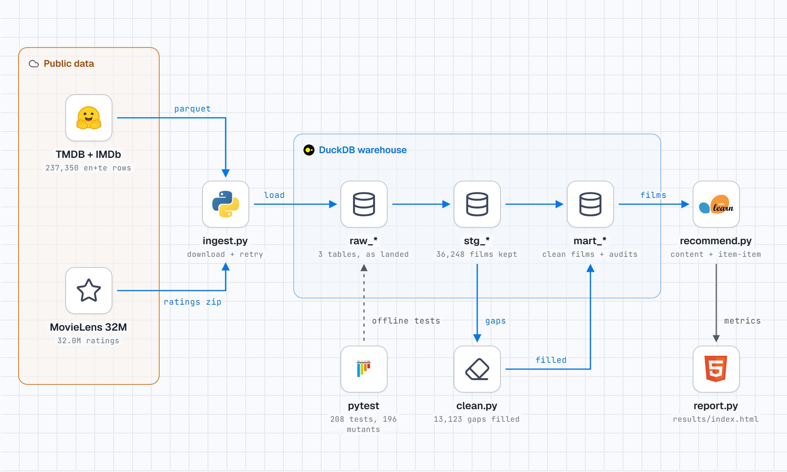

# cinebridge: an English + Telugu movie recommender

**If you liked an English film, which Telugu films should you try, and the other way round?**

cinebridge builds one catalogue of English and Telugu films from real public data, fills every
missing field instead of throwing the film away, and then measures four recommenders against
what real users went on to like. Every number below comes from a captured run; the full
evidence is in [`results/index.html`](results/index.html) (download and open it in a browser).



## What it does, in four steps

1. **Collect.** Film details (TMDB + IMDb) for English and Telugu films, and 32 million ratings
   from MovieLens.
2. **Clean without deleting.** A film with a missing genre, runtime, year, plot, cast or rating
   is kept and the gap is filled. Each filled value is flagged, so you always know what is real
   and what is an estimate.
3. **Recommend.** Four methods are compared:
   - *most popular*: the same list for everyone (the baseline to beat);
   - *content*: films with a similar plot, cast, director and genres to the ones you liked;
   - *item-item*: films liked by the same people who liked your films;
   - *hybrid*: a weighted blend of the three.
4. **Measure honestly.** The models learn only from ratings before a cutoff date and are scored
   on what users liked in the 12 months after it.

## What is different about it

- **Two languages, one catalogue.** All 2,126 Telugu films in the source are kept, however few
  votes they have. Titles keep their Telugu script next to the English title.
- **Fill, never drop.** 13,123 missing values were filled and 0 films were removed for having gaps.
- **The fills are checked.** Real values are hidden, refilled, and compared with the truth.
- **A gap is never a signal.** Two films never look alike just because both were missing the
  same field: filled values and the "Unknown" placeholder are kept out of the similarity maths.
- **Cross-language bridge.** Ask for recommendations in the other language only.

## What the run found

Catalogue: 2,126 Telugu and 34,122 English films. Test window: 12 months from 2022-10-13.
Recall@10 = of the films a user went on to like, the share that appear in their top 10.

| Recall@10 | Users | Most popular | Content | Item-item | Hybrid |
|---|---|---|---|---|---|
| All films | 5,373 | 0.035 | 0.011 | 0.057 | **0.060** |
| Telugu films only | 143 | **0.957** | 0.018 | 0.432 | 0.767 |
| Telugu films, users with no Telugu film in their history | 130 | **0.981** | 0.020 | 0.458 | 0.803 |

- **All films:** hybrid and item-item both clearly beat "most popular". Hybrid's lead over
  item-item is too small to call a winner.
- **Telugu films:** "most popular" wins. One film, RRR, holds 54.7% of all Telugu likes in the
  test window, so a list with RRR on top is right for most users. This is a property of the
  ratings data, not of Telugu cinema (see limits).
- **The Telugu blend did not transfer.** Its weights were picked on only 68 users in the
  validation year, and they did worse on the test year. They were not re-tuned on the test
  data, because that would be marking your own homework.

How good are the filled values? On Telugu films, hiding real values and refilling them:

| Field | Pipeline fill | Simple fill (language median / commonest genres) |
|---|---|---|
| Release year, average error | 7.6 years | 13.6 years |
| Runtime, average error | 15.4 minutes | 16.4 minutes |
| Genres, share with no correct genre | 16% | 18% |

Bridge examples (content similarity only; the full table is on the results page):

| If you liked | Try (other language) |
|---|---|
| Titanic | ప్రేమనగర్ (Prema Nagar), ఇద్దరి లోకం ఓకేట్ (Iddari Lokam Okate), బొమ్మరిల్లు (Bommarillu) |
| The Notebook | ప్రేమమ్ (Premam), మరో చరిత్ర (Maro Charitra), సీతాకోకచిలుక (Seethakoka Chilaka) |
| Sita Ramam | Life in a Year, Love Letters, The Last Letter from Your Lover |

## Limits, stated plainly

- MovieLens users are mostly English-language viewers, not a Telugu audience. Only 259 of the
  2,126 Telugu films have any rating. The Telugu numbers describe this dataset, not Telugu taste.
- One test window. Recall@10 rewards predicting what people rated, not what they would have
  enjoyed if shown.
- The bridge examples are uneven: some are sensible, some are not. They are examples, not proof.
- Filled values are estimates. They are flagged per row and never used to match films.
- Item-item similarity is learned from a 1-in-8 sample of users to keep the run short.

## Run it yourself

Needs [uv](https://docs.astral.sh/uv/), `make` (Git Bash on Windows), about 2 GB of free RAM
and 3 GB of disk. No account or API key is needed; both data sources are public downloads.

```bash
make setup      # Python environment, dependencies, headless Chromium for rendering
make fetch      # download the two source files into data/raw (about 440 MB, once)
make run        # load, clean, model and evaluate on the real data (about 10 minutes)
make recommend LIKE="Inception" LANG=te     # Telugu films for an Inception fan
```

| Command | What it does |
|---|---|
| `make test` | 208 offline tests |
| `make check` | ruff and sqlfluff |
| `make mutate` | breaks the code on purpose 196 ways; every break must fail a test |
| `make diagram` | rebuilds the architecture diagram from the captured run |
| `make results` | rebuilds `results/index.html` |

## Data

| Source | What it is | Used as |
|---|---|---|
| `HenryWaltson/TMDB-IMDB-Movies-Dataset` (Hugging Face) | TMDB metadata joined with IMDb ratings, cast and directors | the film catalogue |
| MovieLens 32M (GroupLens) | 32 million ratings by 200,000 users, 1995 to October 2023 | what users liked, and when |

Scope: every Telugu film; English films with at least 1,000 IMDb votes; no adult titles. The
data itself is not in this repo; `make fetch` downloads it.

## How it works

- **Storage:** DuckDB, in three layers of plain SQL: `raw` (as landed), `staging` (one row per
  film, in scope), `marts` (clean films, audits, the train / validation / test split).
- **Filling (`clean.py`):** year and genres come from the most similar films (plot and people);
  runtime from films of the same language and genre; plot summary and keywords are built from
  the film's own fields; a rating is pulled toward its language average when it has few votes.
- **Similarity (`features.py`):** TF-IDF vectors of plot text, people and genres.
- **Evaluation (`evaluate.py`):** blend weights are chosen on the 12 months before the test
  window and never on the test window itself. Every method is scored on the same users and the
  same candidate films.

## Layout

```
sql/raw|staging|marts   all SQL, run in order by warehouse.py
src/cinebridge/         ingest, warehouse, clean, features, recommend, evaluate, pipeline, report
scripts/                entry points, one per make target
tests/                  offline tests and CATALOG.md (what each test proves)
results/sprint-01/      captured outputs, review.md, architecture diagram
results/index.html      the generated results page
```

How it was checked: tests were written first, two independent reviews (code and tests) and a
re-review are recorded in [`results/sprint-01/review.md`](results/sprint-01/review.md).
