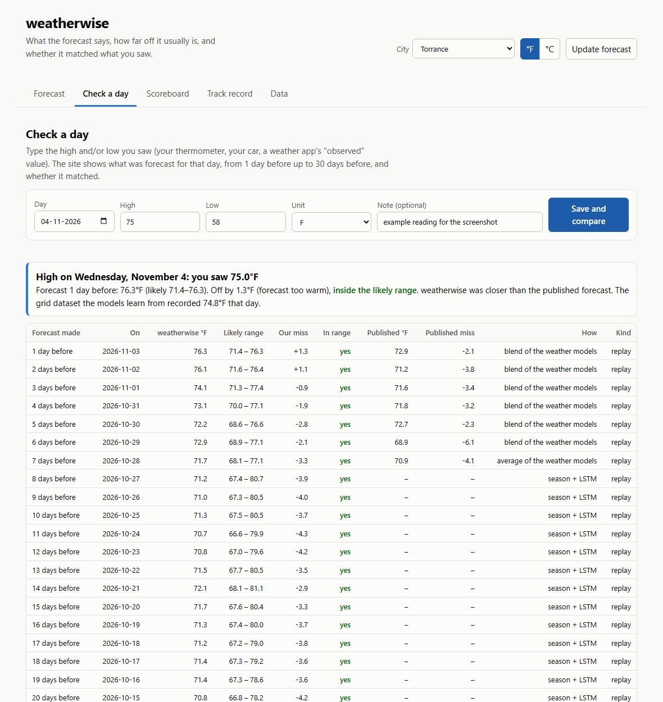
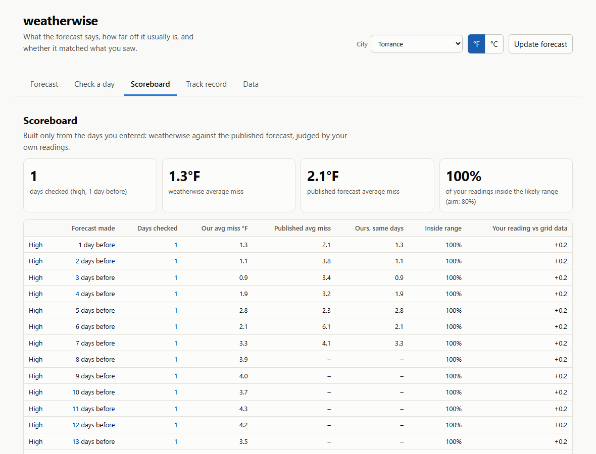
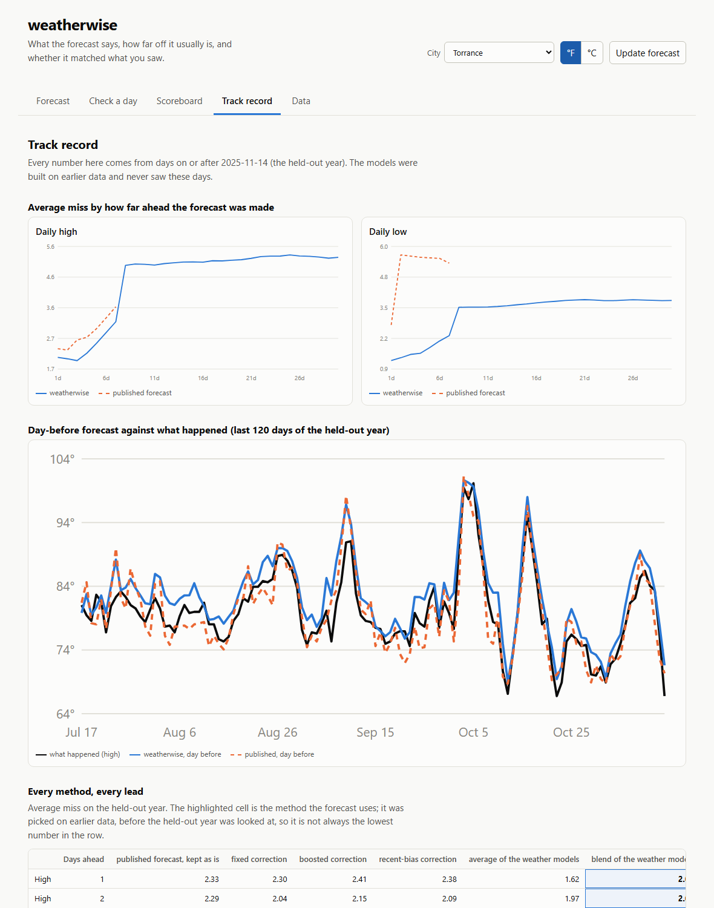
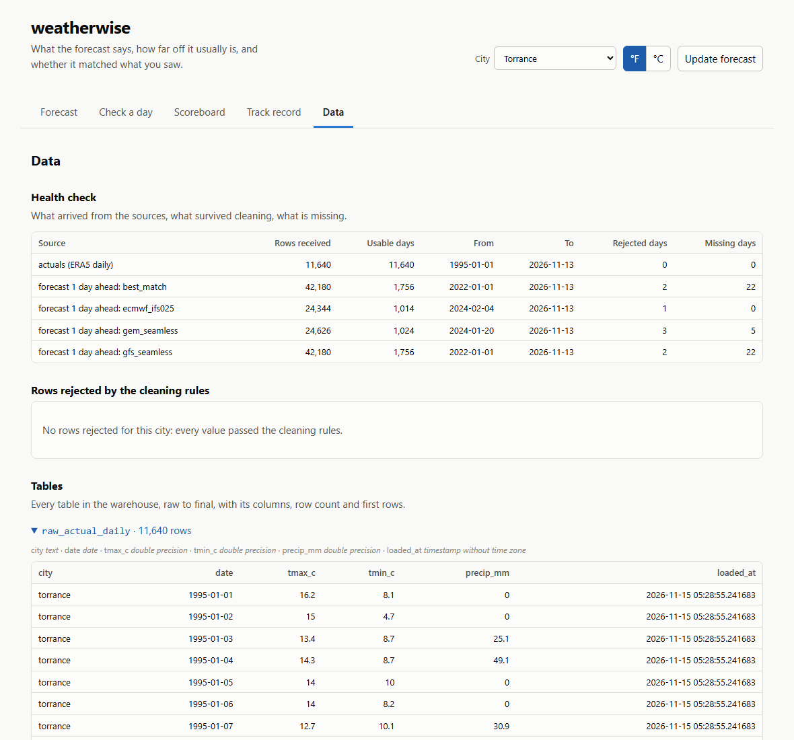
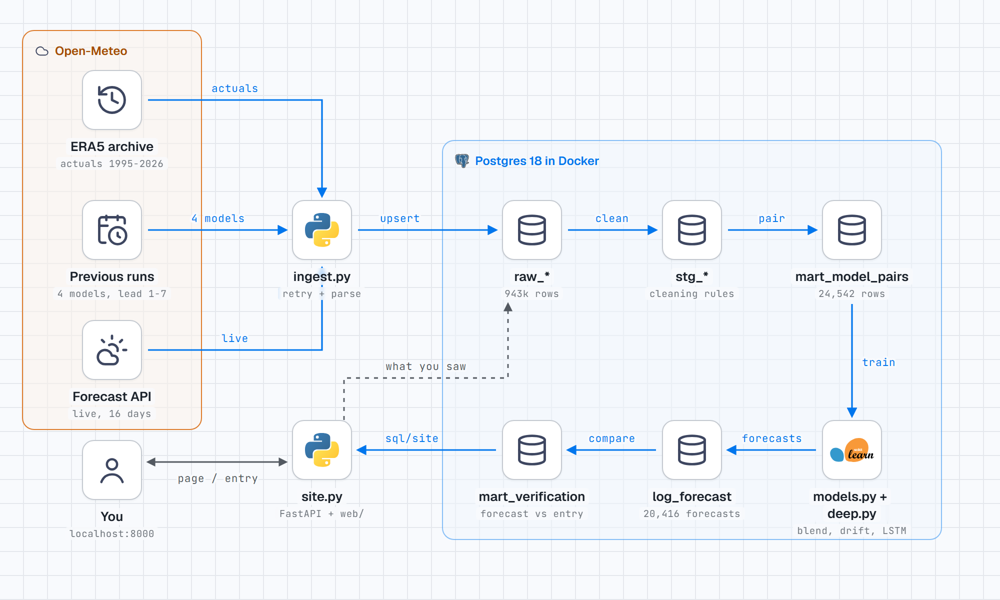

# weatherwise

**The forecast said 28. It hit 31. How often does that happen, and what should you plan for instead?**

weatherwise answers that with real data. It collects what weather models forecast and what
actually happened, measures the gap, corrects the forecast where the data proves it can, and
gives every number a "likely range". Then it lets you check it yourself: type in the temperature
you saw on any day and the site shows what was forecast for that day and how far off it was.

Default city: **Torrance, California** (shown in °F; other cities are one config line).


---

## Contents

1. [What it found for Torrance](#what-it-found-for-torrance)
2. [How the site works](#how-the-site-works)
3. [How the forecast is made](#how-the-forecast-is-made)
4. [The planning assistant](#the-planning-assistant)
5. [Run it](#run-it)
6. [Daily use](#daily-use)
7. [How it is tested](#how-it-is-tested)
8. [Honest limits](#honest-limits)
9. [Repo layout](#repo-layout)
10. [Sprints](#sprints)

---

## What it found for Torrance

All numbers are measured, from `results/sprint-03/metrics/`. "Miss" means the average distance
between forecast and outcome (mean absolute error). 1 °C = 1.8 °F.

**How wrong the published forecast has been (2022 to today, 1,756 days)**

| | 1 day ahead | 7 days ahead |
|---|---|---|
| Daily high, average miss | 1.2 °C (2.2 °F) | 1.7 °C (3.1 °F) |
| Daily high, days off by 3 °C (5.4 °F) or more | 8% | 16% |
| Daily high, worst miss | 7.4 °C (13 °F) | 12.1 °C (22 °F) |
| Daily low, average miss | 2.3 °C (4.2 °F) | 3.3 °C (6.0 °F) |

So "forecast 28, got 31" is not rare: about one day in twelve, even for tomorrow's high.

**Does weatherwise do better? Checked on the last 12 months, which the models never saw**

| Days ahead | High: published | High: weatherwise | Low: published | Low: weatherwise |
|---|---|---|---|---|
| 1 | 1.29 °C | **1.14 °C** | 1.53 °C | **0.70 °C** |
| 2 | 1.27 | **1.11** | 3.16 | **0.76** |
| 3 | 1.45 | **1.08** | 3.13 | **0.84** |
| 4 | 1.50 | **1.21** | 3.10 | **0.87** |
| 5 | 1.65 | **1.39** | 3.09 | **1.00** |
| 6 | 1.84 | **1.58** | 3.08 | **1.15** |
| 7 | 2.04 | **1.77** | 2.97 | **1.28** |

- Highs improve by 12 to 25%. Lows improve by 54 to 76%.
- The big gain on lows has a plain cause: from two days out, the published forecast for
  Torrance runs about 3 °C too warm at night. The correction learns that and removes it.
- **Days 8 to 30:** no model, public or mine, forecasts individual days that far out. The
  30-day line is the seasonal normal nudged by how unusual the last few days were. For highs it
  is only as good as the plain seasonal average (2.8 °C miss). For lows it is a little better
  (2.0 vs 2.3 °C).
- **The likely range** is meant to hold the real value 8 times in 10. Measured: 73 to 80% for
  days 1 to 7, and 67 to 74% for days 8 to 30. It runs slightly narrow, and the page says so.

---

## How the site works

Start it with `make site` and open <http://localhost:8000>. Six tabs:

### 1. Forecast


- **Seven cards**, one per day: the forecast high and low, the likely range for each, and the
  published forecast underneath for comparison. The small tag says how that number was made.
- **Two 30-day charts** (high, low): blue line = weatherwise, dashed orange = published,
  shaded band = likely range. Hover for exact values.
- **°F / °C** switch at the top. **Update forecast** fetches today's data and re-forecasts
  (a few minutes).

### 2. Check a day


This is the part you asked for.

1. Pick the day, type the high and/or low you saw, choose °F or °C, press **Save and compare**.
2. The site shows a verdict in one sentence: what was forecast the day before, how far off it
   was, whether your reading fell inside the likely range, and whether weatherwise or the
   published forecast was closer.
3. Below that, a table with every forecast made for that day: 1 day before, 2 days before, and
   so on back to 30 days before.

Two kinds of rows appear:

| Kind | What it is |
|---|---|
| **Issued live** | The first forecast the site made on that date. Later runs the same day cannot change it. |
| **Replay** | What the models would have said, re-run over the last 12 months, which they were not trained on. This is why you can check a day from last month on your first visit. |

Typing the same day again edits your entry. Your entries are also saved to
`data/user_observations.csv`, so they survive a database rebuild.

### 3. Scoreboard


Built only from days you entered: how many days you checked, weatherwise's average miss, the
published forecast's average miss on the same days, and how often your reading fell inside the
likely range. One more column, **your reading vs grid data**, shows whether your thermometer
runs steadily warmer or cooler than the dataset the models learn from. A steady gap is your
location, not a forecast error.

### 4. Track record


The evidence behind the tables above: average miss by days ahead, the last 120 days of
day-before forecasts against what happened, and a leaderboard of every method at every lead with
the chosen one highlighted.

### 5. Data


A health check (rows received, usable days, rejected days, missing days per source) and every
table in the database, raw to final, with its columns, row count and first rows.

### 6. Ask

A chat box over the same tables. Ask a planning question ("Is Saturday warm enough for the
beach, and how sure is that?"). Under each answer the page lists which tables were read and
whether the numbers passed the check described in
[The planning assistant](#the-planning-assistant). It needs an Anthropic API key in `.env`;
without one the tab says so and the rest of the site works as before.

---

## How the forecast is made



**1. Collect** (Open-Meteo, free, no API key)

| Source | What | Used as |
|---|---|---|
| Historical archive | Daily high and low, 1995 to yesterday | what happened |
| Previous-runs archive | Hourly forecasts as issued 1 to 7 days earlier, from up to 4 weather models (two from 2022, two more from early 2024) | what was forecast |
| Forecast API | Today's 16-day forecast from the same 4 models | input to today's outlook |

**2. Store and clean** (Postgres, plain SQL files in `sql/`)

- Loads can be repeated safely: the same data loaded twice leaves the same rows.
- Cleaning rules reject impossible values (outside -60 to 60 °C), days where the high is below
  the low, and forecast days without all 24 hours. Rejected rows are listed, not hidden.

**3. Correct the next 7 days.** For each number of days ahead, six methods compete:

| Method | Idea |
|---|---|
| Published, as is | keep the forecast unchanged |
| Fixed correction | a constant adjustment by season (linear, or gradient boosting) |
| Recent-bias correction | subtract the forecast's average error over the last few weeks |
| Model average | the mean of the weather models |
| Blend | gradient boosting over all models, how much they disagree, and the recent bias |

The winner is chosen by a rolling test inside the training data and must beat the published
forecast by at least 2%, otherwise the published forecast is kept. For Torrance the blend won
almost everywhere.

**4. Days 8 to 30.** Seasonal normal (30 years, with the warming trend) plus an anomaly forecast.
Three candidates: a simple fading anomaly, an LSTM neural network, and their average. The choice
is made on a validation year.

**5. The likely range** comes from the last 120 misses that were known on the day the forecast
was made, so it widens when recent forecasts have been poor.

**6. Log everything.** Every forecast is stored with its issue date. That log is what the site
compares your readings against.

---

## The planning assistant

The forecast numbers come from the statistical models above. A language model cannot lower a
temperature error; arithmetic on measured errors can. The assistant's job is different: read
those numbers and turn them into a plain answer to a planning question. It is built with
LangGraph and calls Claude through the API.

**What it can do**

| Tool | What it reads |
|---|---|
| `get_outlook` | the newest forecast: high, low and likely range per day, 1 to 30 days |
| `get_forecast_error_by_lead` | how far off forecasts have been, by days ahead |
| `check_day` | a day you entered: every forecast made for it against your reading |
| `get_scoreboard` | the score on your own readings |
| `get_data_health` | what data arrived, what was rejected, when the forecast last ran |
| `remember_preference`, `recall_preferences` | your units, home city, temperature thresholds |

Each data tool is one fixed SQL file in `sql/agent/` with typed arguments. There is no tool
that accepts SQL, and none that writes a forecast.

**The four rules it is built around**

1. **It cannot change data.** Tool queries run as a database role that can only read five
   tables and views, inside a transaction with a 10-second limit. A test tries to delete,
   insert and read raw tables through it; all three are refused by Postgres.
2. **It cannot state a number the database does not hold.** After the model answers, code
   compares every number and date in the answer with the tool results, the tool arguments
   and your own words. If one is missing, the model gets one chance to rewrite. If it is
   still there, you see a refusal instead of the answer. Tool results carry both °C and °F
   so the model never converts units itself.
3. **Nothing is lost on a crash.** The conversation is saved to Postgres after every step.
   Each tool call is written to `agent.tool_call` with a unique id and its result, so a run
   that is killed part-way resumes from the last step and returns the finished tool's stored
   result instead of running it again.
4. **Failures are said out loud.** A slow query is cancelled and retried twice with a
   growing pause; if the data still cannot be read the assistant says so and does not
   estimate. A model outage produces a clear message, not an answer. Each conversation stops
   after 200 model calls.

**The graph**

```
question -> route -> model -> tools -> model -> ... -> answer check -> reply
            |        |        |                        |
            |        |        |                        +- unsupported number: one rewrite, then refuse
            |        |        +- validate arguments, run as read-only role, log, retry, replay
            |        +- count the call, stop at the limit, report an outage
            +- load saved preferences
```

**Memory.** Two kinds, both in Postgres. The conversation (a *thread*) is checkpointed, so
you can close the page and continue later. Preferences are stored per user and shared by all
of that user's threads: say "use Fahrenheit" once and a new conversation knows it.

**Evidence**, in `results/sprint-04/`:

- `run/resume.out`: a process is killed inside its second tool call; a new process resumes
  the thread; the first tool is not run again. All 8 checks pass on the real Torrance data.
- `metrics/02_tool_calls_resume_proof.csv`: the tool-call log of that run.
- `review.md`: findings from two independent reviews and what was done about each.

- `run/live.out`: five questions put to Claude on the real data.

**What a real session looked like** (from `run/live.out`, shortened):

> **Q:** From now on use Fahrenheit, my home city is Torrance, and warn me about any day above 75 F.
> *three `remember_preference` calls*
>
> **Q, in a new conversation:** Any days in the next week I should worry about?
> *`get_outlook`, `get_forecast_error_by_lead`*
> **A:** No day in the next week looks like a problem. Every forecast high stays below your
> hot-day threshold, and the top of every high range is also below it. [...] Today, Sunday:
> the high is 72.1 F, likely between 70.2 and 74.5 F. This is the warmest day, and the top of
> its range is the closest to your threshold.
>
> **Q:** What will the high be in Torrance on Christmas Day, December 25?
> *`get_outlook` (30 days: the data stops before then)*
> **A:** I cannot give that answer: it contained figures that are not in the forecast data I
> can read. [...]

Four of the five answers passed the number check. The Christmas one was refused: the model's
rewritten answer still held a number that no tool had returned.

**Where the check falls short, seen in that same run.** One answer said the two forecasts
differ by "0.5 F". The model had subtracted two tool numbers itself, which the rules forbid,
and it passed, because 0.5 also appears elsewhere in that tool result. The check matches
digits; it does not know what a number is attached to. A scored question set that grades
answers against the database is the next sprint.

---

## Run it

Needs: Docker Desktop, [uv](https://docs.astral.sh/uv/), `make` (Git Bash on Windows).

```bash
make setup      # Python environment and dependencies
make up         # start Postgres in Docker (127.0.0.1:15480)
make run        # fetch real data, load, train, forecast (about 5 minutes the first time)
make site       # open http://localhost:8000
```

For the assistant, copy `.env.example` to `.env` and set `ANTHROPIC_API_KEY`. Then use the
Ask tab, or the terminal:

```bash
make agent Q="Is Saturday warm enough for the beach, and how sure is that?"
```

Other commands:

```bash
make test       # 184 tests against a real Postgres test database
make check      # ruff + sqlfluff
make mutate     # break the code on purpose; every break must fail a test
make prove-resume  # kill the assistant mid-run, resume it, check nothing ran twice
make results    # rebuild results/index.html (every sprint, every table, every output)
make down       # stop Postgres (data is kept in a Docker volume)
```

Another city: `make run CITY=chennai`. Add your own in `src/weatherwise/config.py`.

Settings live in `.env` (copy `.env.example`). Nothing secret is in the repo.

---

## Daily use

1. Open the site. If the forecast date is not today, press **Update forecast**.
2. In the evening, or the next day, open **Check a day** and type what you saw.
3. After a couple of weeks the **Scoreboard** tells you, on your own readings, whether
   weatherwise or the published forecast has been closer.

The live forecasts are the fair test: the first one made each day is stored before the day
happens, and nothing can change it afterwards.

---

## How it is tested

- **Tests first.** Each test was seen failing before its code existed
  (`results/<sprint>/run/red*.out`), then passing. 184 tests, listed with the bug each one
  catches in [`tests/CATALOG.md`](tests/CATALOG.md).
- **Real database.** Tests run against Postgres, not a mock.
- **Mutation check.** A script breaks the code in 131 specific ways (flip a sign, drop a
  key column, let the model peek at the future). Each break must make a named test fail. This sprint the 52 breaks of the assistant's files were run (52 caught); the 79 older ones were last run in sprint 03.
- **The assistant is tested offline.** A scripted stand-in replaces the model, so tests
  need no API key and give the same result every time. They cover the read-only role, the
  tool log and replay, timeouts and retries, the number check, the call limit, preferences
  across conversations and resume after a crash.
- **No peeking.** The last 12 months are never used to fit, choose or tune anything. Tests
  inject a +10 °C jump into that window and assert nothing learned from it.
- **Two independent reviews per sprint**, one of the code and one of the tests. Findings and
  fixes are in `results/<sprint>/review.md`.
- **Everything shown is generated.** [`results/index.html`](results/index.html) is built by a
  script from captured files: commands, terminal output, tables before and after, charts.

---

## Honest limits

- **Your thermometer is not the dataset.** "What happened" is a gridded analysis for the area
  around Torrance, not a station in your yard. Readings can sit a steady 1 to 3 °C away. The
  scoreboard reports that gap separately so it is not mistaken for forecast error.
- **One held-out year.** Differences under about 0.1 °C are noise.
- **Days 8 to 30 are a seasonal expectation with a range**, not a weather forecast.
- **The range runs a little narrow** (73 to 80% instead of 80%). For days 8 to 30 the band
  currently sits mostly above the line, because recent months ran warmer than the seasonal
  model expected.
- **The method list was revised once after seeing the held-out numbers** (the adaptive range and
  the averaged long-range candidate). From here on, the fair evidence is the live forecast log
  against your entries.
- **For Torrance, two of the four weather models are the same series**, so the blend really has
  three independent inputs.
- Temperature only. Rain is fetched but not modelled.
- **The assistant's number check reads digits, not meaning.** It stops invented figures. It
  does not check that a correct number is attached to the right day, and it refuses a sum
  or difference the model works out itself, even a correct one.
- **One local user.** Conversations are not access-controlled.

---

## Repo layout

```
docker-compose.yml       Postgres for local use
sql/migrations/          table definitions, applied in order
sql/raw/                 loaders (insert ... on conflict)
sql/staging/, sql/marts/ cleaning rules, forecast-vs-actual tables, verification views
sql/site/, sql/checks/   the site's queries, checksum and test reset
sql/agent/               the assistant's tool queries and its read-only grants
src/weatherwise/         ingest, warehouse, models, deep (LSTM), pipeline, observations, site, report
src/weatherwise/agent/   tools, grounding (the number check), graph, scripted (offline model)
web/                     the site's page, script and styles
scripts/                 one entry point per make target
tests/                   tests and CATALOG.md
results/<sprint>/        captured outputs; results/index.html covers every sprint
docs/                    spec, tickets, project standards
data/                    CSV backups of your entries and the live forecast log
```

---

## Sprints

| Sprint | What | State |
|---|---|---|
| 01 | Forecast-error audit and first 7/30-day outlook (Bengaluru, DuckDB) | done |
| 02 | Torrance, four weather models, blend and recent-bias correction, LSTM, forecast log, site | built on DuckDB, frozen, carried into 03 |
| 03 | Port to Postgres in Docker: migrations, safe reloads, same numbers | done |
| 04 | LangGraph planning assistant: typed read-only SQL tools, checkpoints, memory, logged tool calls, number check | this sprint |
| 05 | Operations: daily run, drift detection with approval, scored question set, fault injection | planned |

Plan and acceptance criteria: [`docs/spec-postgres-agent.md`](docs/spec-postgres-agent.md).
