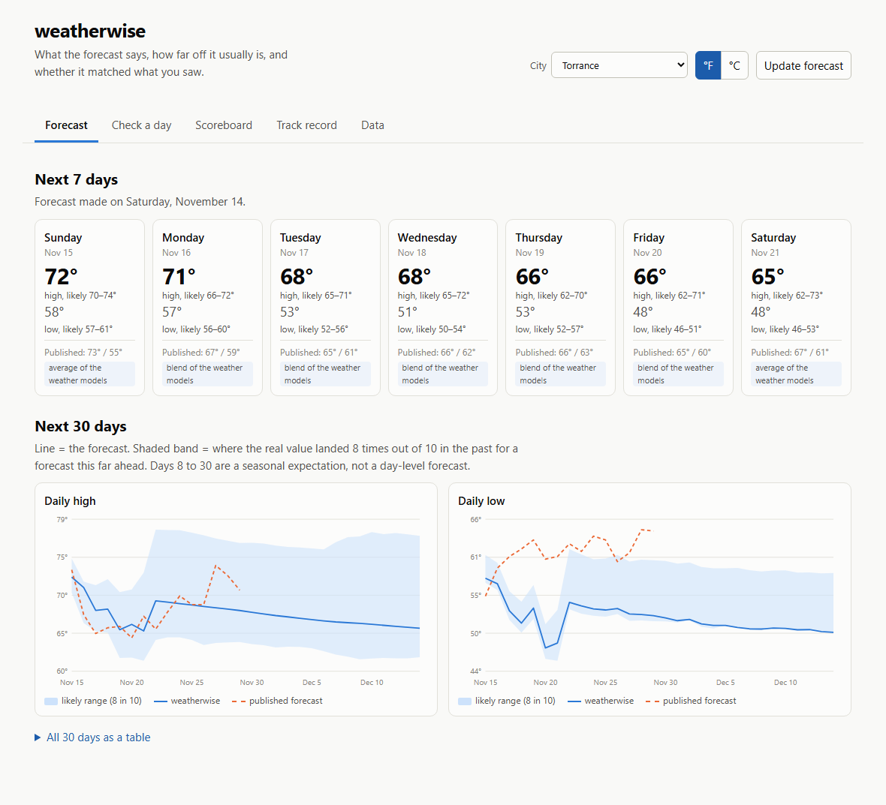
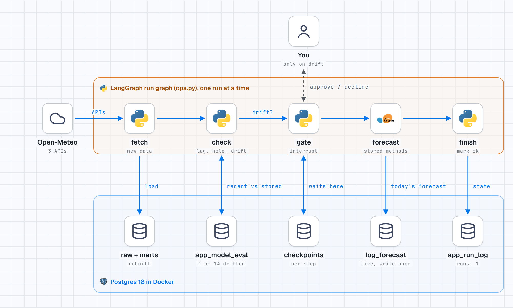

# weatherwise

**The forecast said 28. It hit 31. How often does that happen, and what should you plan for instead?**

weatherwise answers that with real data. It collects what weather models forecast and what
actually happened, measures the gap, corrects the forecast where the data proves it can, and
gives every number a likely range. You can check it yourself: type in the temperature you saw
and the site shows what was forecast for that day and how far off it was.

Default city: **Torrance, California**. Other cities are one config line.



The long version, with every tab, step and piece of evidence, is in
[docs/full-guide.md](docs/full-guide.md).

## What it found for Torrance

Average miss on the last 12 months, which the models never saw (°C; 1 °C = 1.8 °F):

| Days ahead | High: published | High: weatherwise | Low: published | Low: weatherwise |
|---|---|---|---|---|
| 1 | 1.29 | **1.14** | 1.53 | **0.70** |
| 3 | 1.45 | **1.08** | 3.13 | **0.84** |
| 7 | 2.04 | **1.77** | 2.97 | **1.28** |

- Highs improve by 12 to 25%, lows by 54 to 76%. From two days out, the published forecast
  runs about 3 °C too warm at night; the correction learns that and removes it.
- "Forecast 28, got 31" is not rare: the published high for tomorrow is off by 3 °C or more
  about one day in twelve.
- Days 8 to 30 are a seasonal expectation with a range, not a weather forecast.
- The likely range is meant to hold the real value 8 times in 10. Measured: 73 to 80% for
  days 1 to 7.

## What is in it

| Part | What it does |
|---|---|
| Pipeline | Fetches Open-Meteo data, stores and cleans it in Postgres with plain SQL, picks the best of six correction methods per day ahead, logs every forecast with its issue date |
| Site | Six tabs: forecast, check a day you observed, scoreboard on your own readings, track record, data health, and a chat box |
| Assistant | A LangGraph agent that calls Claude. It reads the tables through fixed read-only queries and withholds any answer containing a number the database does not hold |
| Daily run | `make daily`: fetch, check, forecast. It keeps the chosen methods, and if they have drifted it stops and waits for you to approve or decline retraining |



## Run it

Needs Docker Desktop, [uv](https://docs.astral.sh/uv/) and `make` (Git Bash on Windows).

```bash
make setup      # Python environment and dependencies
make up         # start Postgres in Docker (127.0.0.1:15480)
make run        # fetch real data, load, train, forecast (about 5 minutes the first time)
make site       # open http://localhost:8000
```

For the assistant, copy `.env.example` to `.env` and set `ANTHROPIC_API_KEY`. Nothing secret
is in the repo.

| Command | What it does |
|---|---|
| `make daily` | the every-morning run; answer a drift stop with `--approve` or `--decline` |
| `make agent Q="..."` | ask the assistant from the terminal |
| `make test` | 221 tests against a real Postgres test database |
| `make check` | ruff and sqlfluff |
| `make mutate` | break the code on purpose; every break must fail a test |
| `make faults` | break the daily run six ways and check where each one ends |
| `make eval` | score the assistant against the database (needs the API key) |
| `make results` | rebuild [`results/index.html`](results/index.html) |
| `make down` | stop Postgres (data is kept in a Docker volume) |

Another city: `make run CITY=chennai`.

## How it is tested

- Each test was seen failing before its code existed, then passing. All 221 are listed in
  [`tests/CATALOG.md`](tests/CATALOG.md) with the bug each one catches.
- A mutation script breaks the code in 180 specific ways; each break must fail a named test.
  The 49 breaks of the latest sprint were all caught. The older 131 were last run in their
  own sprints.
- The last 12 months are never used to fit, choose or tune anything.
- Fault injection: 13 of 13 checks pass (API down, late data, database restart, drift).
- The assistant answered a 14-question set correctly on 42 of 42 attempts. Its instructions
  were tuned on those same questions, so treat that as a floor check, not a score.
- Two independent reviews per sprint; findings are in `results/<sprint>/review.md`.

## Limits

- "What happened" is gridded data for the area, not a thermometer in your yard. Your
  readings can sit a steady 1 to 3 °C away.
- One held-out year: differences under about 0.1 °C are noise.
- Temperature only. Rain is fetched but not modelled.
- The assistant's number check reads digits, not meaning: it stops invented figures but does
  not check that a number is attached to the right day.
- The drift check scores replayed forecasts until enough live days exist (the live log
  started on 2026-11-14), so its flag on the 1-day low did not clear after re-selection.
- Nothing schedules the daily run; it is run by hand or by a task you set up.

The complete list is in the [full guide](docs/full-guide.md#honest-limits).

## Sprints

| Sprint | What |
|---|---|
| 01 | Forecast-error audit and first 7/30-day outlook |
| 02 | Torrance, four weather models, blend, LSTM, forecast log, site |
| 03 | Port to Postgres in Docker |
| 04 | LangGraph planning assistant |
| 05 | Daily run, drift gate, fault injection, scored questions |

Spec: [`docs/spec-postgres-agent.md`](docs/spec-postgres-agent.md).
